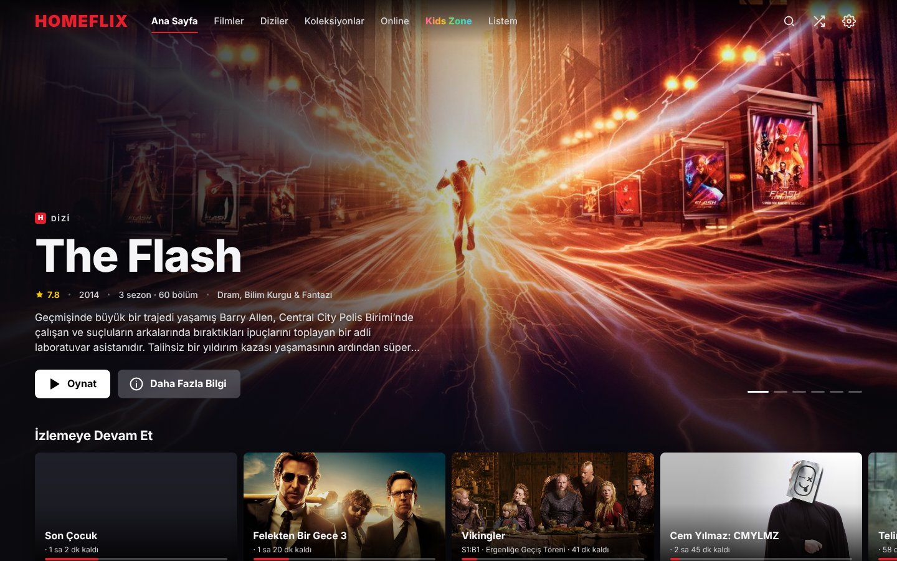
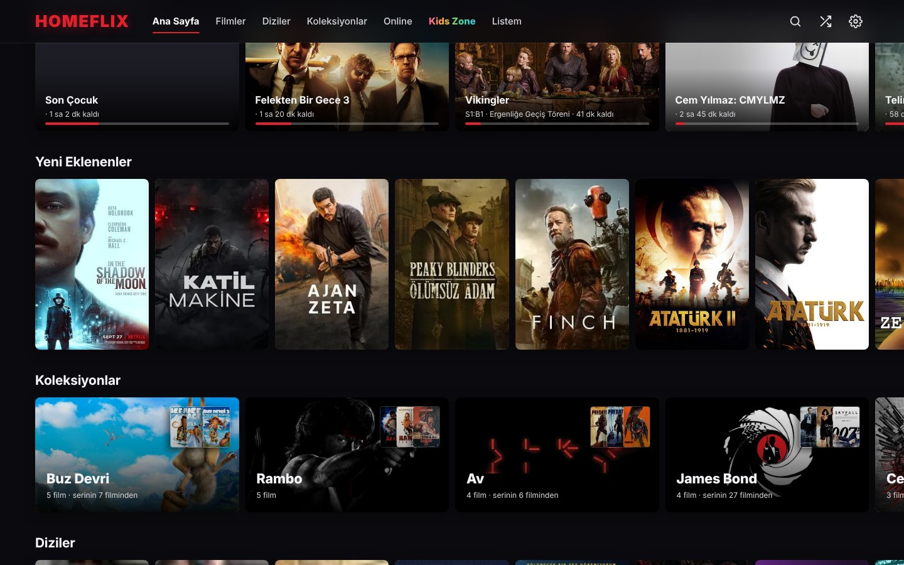
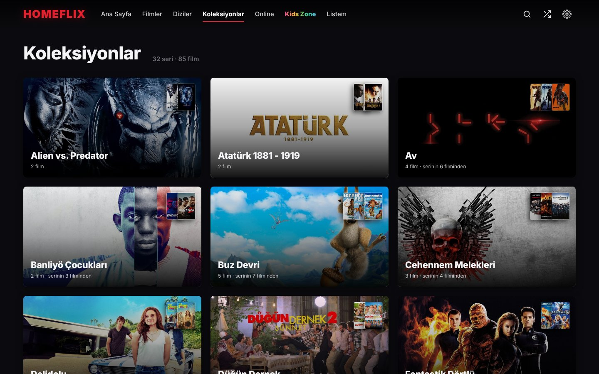

# Homeflix 2

Ev ağı için kişisel film ve dizi platformu: kendi bilgisayarındaki filmleri ve dizileri Netflix benzeri bir arayüzle telefondan, TV'den ve tarayıcıdan izle.

*Self-hosted home media server and Netflix-style player for your own movie and TV library (a lightweight Plex / Jellyfin alternative): TMDb posters and metadata, collections, resume playback, live transcoding of MKV/AVI, subtitles from OpenSubtitles. Python + Flask, runs on Linux and Windows.*



```bash
./run.sh              # uygulama penceresi
./run.sh --browser    # varsayılan tarayıcıda
./run.sh --headless   # yalnızca sunucu
```

Diğer cihazlardan: `http://<bilgisayarın-ip-adresi>:5000` (adres Ayarlar ekranında yazar).
Farklı port için: `HOMEFLIX_PORT=5001 ./run.sh`.

## Getting your API keys

**OMDb API key** (for posters & metadata)
1. Go to https://www.omdbapi.com/apikey.aspx
2. Select the FREE tier (1,000 daily requests)
3. Enter your email and submit
4. Check your email for the API key
5. Paste it into Home Theater settings

**OpenSubtitles API key** (for subtitles, optional)
1. Create an account at https://www.opensubtitles.com
2. Go to https://www.opensubtitles.com/consumers
3. Register a new consumer/app to get your API key
4. Paste it into Home Theater settings

## Neler var

- **Ana sayfa:** Dönen öne çıkan alan, İzlemeye Devam Et, Listem, Yeni Eklenenler, Koleksiyonlar, Diziler, En Yüksek Puanlılar, türe göre satırlar
- **Koleksiyonlar:** Devam filmleri (Matrix 1-2-3, Felekten Bir Gece 1-2-3, Harry Potter…) TMDb'den otomatik gruplanır. TMDb'de olmayanlar isimdeki numaraya göre gruplanır.
- **Detay sayfası:** Arka plan görseli, süre, türler, koleksiyon şeridi, benzer içerikler. Aynı filmin birden fazla dosyası "Sürümler" altında toplanır.
- **Diziler:** TMDb'den bölüm adları, açıklamaları ve görselleri. Bölüm başına ilerleme çubuğu ve "İzlendi" işareti. Aynı dizinin farklı klasörlerdeki bölümleri birleştirilir.
- **Oynatıcı:**
  - Tarayıcının açamadığı dosyalar (mkv, avi, ts, VOB) anında canlı dönüştürülerek oynatılır.
  - Ses parçası seçilebilir (dublaj / orijinal).
  - Altyazı kaynakları: yerel `.srt/.vtt/.ass`, mkv içine gömülü altyazılar, OpenSubtitles araması, dosyadan yükleme ya da sürükle-bırak.
  - Altyazı boyutu, arka planı ve senkronu (±0,5 sn) ayarlanabilir.
  - Kaldığın yerden devam edilir, sıradaki bölüm geri sayımla otomatik açılır.
  - Hız ayarı, klavye kısayolları ve tam ekran var.
- **Online:** Kütüphanende olmayan film ve diziler. Liste ve arama TMDb'den gelir, oynatma frameXTV'nin oynatıcısıyla internetten yapılır (indirme yok). Kaldığın yerden devam, İzlemeye Devam Et ve Listem online içeriklerde de çalışır. Kütüphanende olanlar "KÜTÜPHANEDE" etiketiyle gösterilir. Katalog ve posterler sunucuya kaydedilir; interneti olmayan cihazlar da listeyi, posterleri ve puanları görür (video için internet gerekir). Sunucu internete çıkabildiğinde kataloğu 6 saatte bir yeniler, internet yoksa 10 dakikada bir dener. Oynatıcı adresi `secrets.json` içindeki `online_embed` ya da `HOMEFLIX_ONLINE_EMBED` ile değiştirilebilir.
- **Listem ve izleme ilerlemesi** sunucuda tutulur. Telefonda yarım bırakılan film bilgisayarda kaldığı yerden açılır.
- **Arama:** Anlık arama. `/` tuşu ile açılır. Türkçe karakterlere duyarsızdır ("sirin" → "Şirin").

## Ekran görüntüleri





## Yapı

```
app.py                 giriş noktası (sunucu + pencere)
homeflix/
  config.py            yollar, API anahtarları
  db.py                SQLite şeması ve göçler
  names.py             dosya adından başlık / sezon / bölüm çıkarımı
  library.py           disk taraması, Emby/Jellyfin .nfo ve afişleri
  metadata.py          TMDb/OMDb zenginleştirme, koleksiyonlar, bölüm bilgileri
  media.py             ffprobe analizi, canlı akış, görsel önbelleği
  subtitles.py         yerel, gömülü ve çevrimiçi altyazılar
  api.py               HTTP uçları
templates/index.html   sayfa iskeleti ve simgeler
static/app.css         tasarım sistemi
static/app.js          arayüz ve oynatıcı
data/                  veritabanı, afişler, önbellek (v1'den kopyalandı)
```

v1 (`../Homeflix_Linux`) olduğu gibi duruyor, v2 ondan bağımsız çalışır.
